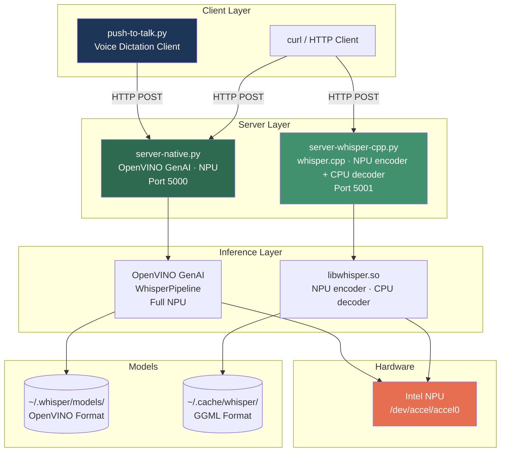
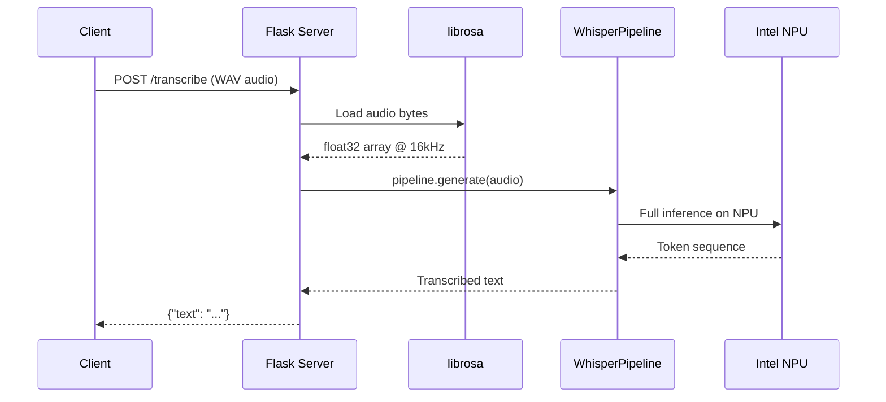
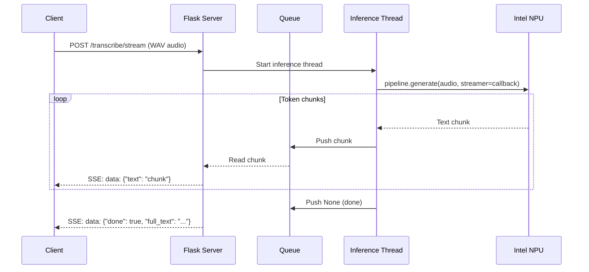
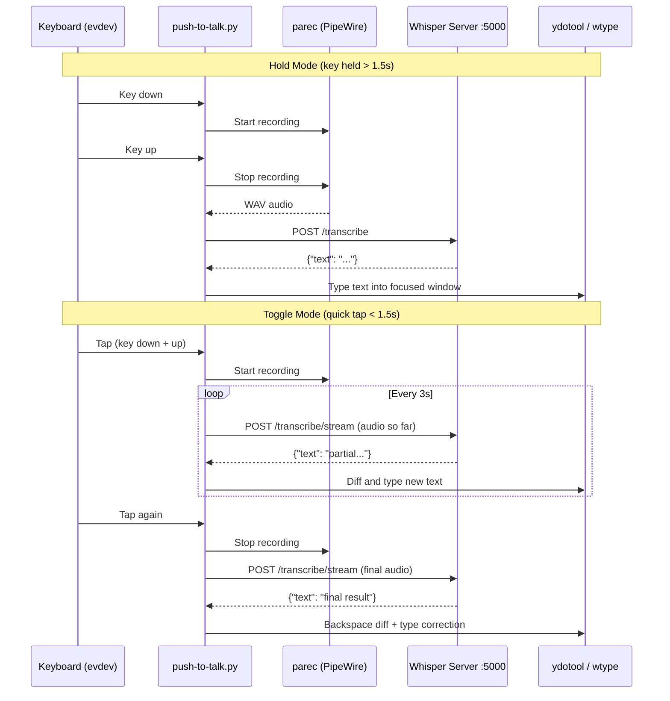
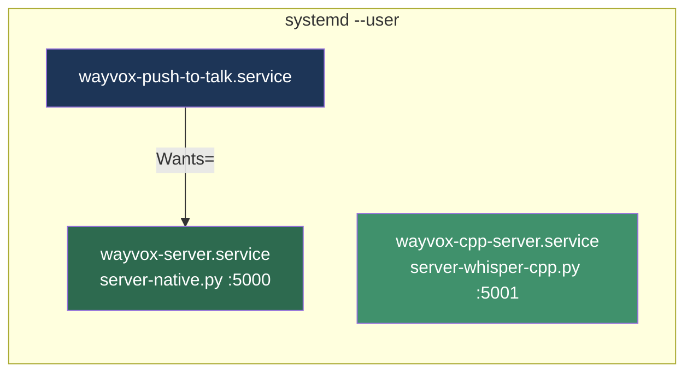

# Wayvox


**Private voice, local power.**

On-device speech-to-text and push-to-talk dictation for Linux. Wayvox runs Whisper locally through OpenVINO, Intel NPU/GPU, CUDA, or CPU backends, then types the result into the focused Wayland application.

Wayvox keeps existing `WHISPER_*` environment variables, config paths, and model paths for compatibility. User services now use `wayvox-*` names.

See [branding/README.md](branding/README.md) for product voice, palette, and icon direction.

## Quick Start

```bash
git clone git@github.com:dmzoneill/wayvox.git
cd wayvox
make install        # installs deps, system packages, default model, services, permissions
make start          # starts wayvox-server, wayvox-cpp-server, wayvox-push-to-talk
make status         # check service status
make test           # hit health/model endpoints
```

Repository is now `dmzoneill/wayvox`. Runtime services, product copy, and assets use Wayvox.

That's it. `make install` downloads the default model (`whisper-small.en-fp16-ov`) automatically. See [Models](#models) below for installing additional models.

## Usage Examples

### Transcribe an audio file

```bash
curl -X POST http://127.0.0.2:5000/transcribe --data-binary @recording.wav
# {"text": "This is the transcribed text."}
```

### Stream transcription (real-time token-by-token via SSE)

```bash
curl -N -X POST http://127.0.0.2:5000/transcribe/stream --data-binary @recording.wav
# data: {"text": "This is "}
# data: {"text": "the transcribed "}
# data: {"text": "text."}
# data: {"done": true, "full_text": "This is the transcribed text."}
```

### Use a specific model

```bash
curl http://127.0.0.2:5000/models
# {"models": ["whisper-small.en-fp16-ov", "whisper-base.en"]}

curl -X POST http://127.0.0.2:5000/transcribe/whisper-base.en --data-binary @recording.wav
```

### Voice dictation (push-to-talk)

The push-to-talk service starts automatically. By default it uses Right Ctrl:

- **Hold** Right Ctrl for >1.5s — records while held, transcribes on release, types into the focused window
- **Tap** Right Ctrl quickly — starts recording with live streaming, tap again to stop

Check its logs with `make logs-ptt`.

## Architecture



The primary server (`server-native.py`) runs the full Whisper pipeline on the NPU. The secondary server (`server-whisper-cpp.py`) runs the encoder on NPU but the decoder on CPU. Push-to-talk defaults to the primary NPU server.

## Data Flow

### Batch Transcription



### Streaming Transcription



### Push-to-Talk Voice Dictation



## Servers

### server-native.py (Primary — Full NPU)

OpenVINO GenAI server running the complete Whisper pipeline on the Intel NPU. Supports batch and real-time SSE streaming transcription.

| Endpoint | Method | Description |
|----------|--------|-------------|
| `/models` | GET | List available models |
| `/transcribe` | POST | Batch transcription (default model) |
| `/transcribe/<model>` | POST | Batch transcription (named model) |
| `/transcribe/stream` | POST | SSE streaming transcription (default model) |
| `/transcribe/stream/<model>` | POST | SSE streaming transcription (named model) |

Environment variables:
- `WHISPER_DEVICE` — inference device: `NPU`, `CPU`, `GPU` (default: `NPU`)
- `WHISPER_MODEL` — default model name (default: `whisper-small.en-fp16-ov`)

Models are loaded from `~/.whisper/models/` in OpenVINO format.

### server-whisper-cpp.py (Secondary — NPU encoder, CPU decoder)

Whisper.cpp server using ctypes bindings to `libwhisper.so`. The encoder runs on NPU via OpenVINO acceleration, but the decoder runs on CPU.

| Endpoint | Method | Description |
|----------|--------|-------------|
| `/transcribe` | POST | Batch transcription |
| `/transcribe/stream` | POST | Transcribe last 30s of audio |
| `/health` | GET | Health check |

```
python3 server-whisper-cpp.py --port 5001 --model ~/.cache/whisper/ggml-base.bin --device NPU
```

Models are GGML format stored in `~/.cache/whisper/`.

## Push-to-Talk Client

Desktop voice dictation client for GNOME/Wayland. Listens for a hotkey via evdev, records audio through PipeWire, sends it to the whisper server on port 5000, and types the result into the focused window.

```
python3 push-to-talk.py --key KEY_RIGHTCTRL --backend openvino --stream-interval 3.0
```

**Two modes of operation:**

- **Hold mode** — hold the key for >1.5 seconds. Audio is recorded while held, transcribed on release, and typed as a single block.
- **Toggle mode** — quick tap (<1.5s). Recording starts immediately with live incremental transcription every few seconds. Tap again to finalize. Uses a diff algorithm to backspace and retype only the changed suffix when the model corrects earlier words.

**Typing backends** (tried in order on Wayland): `ydotool` → `wtype` → `wl-copy` (clipboard fallback). On X11: `xdotool`.

## Technical vocabulary

Whisper often hears computer terms as everyday words (`polar quest` instead of `pull request`). Two fixes run on every transcription:

1. **Bias.** A term list is sent as the Whisper `initial_prompt` and as `hotwords`. CPU, GPU, and faster-whisper accept both. On NPU the pipeline is compiled with `word_timestamps=True`, which raises the prompt slot from 4 tokens to 447 so the term list fits. `make install` writes `WHISPER_NPU_WORD_TIMESTAMPS=1` and `WHISPER_CACHE_DIR=~/.cache/whisper-npu` into the user service. The first start after that compiles for a few minutes. Later starts reuse the cache. Set `WHISPER_NPU_WORD_TIMESTAMPS=0` to keep the 4 token slot. Do not set `MAX_PROMPT_LEN`. The encoder rejects that name. GenAI 2025.4's static pipeline still rejects the bias arguments. A rejection drops them for the rest of the process. The journal line starts with `Failover:`. `GET /health` reports `bias.mode` as `pending`, `on`, `partial`, or `regex`, plus `word_timestamps`.
2. **Replacements.** Python regular expressions rewrite leftovers the model still gets wrong. These run on every device, including after a bias failover.

Built-in lists cover git, GitHub, Kubernetes, containers, databases, web APIs, languages, and Linux commands. `make install` copies `share/vocabulary.json` to `~/.config/whisper-npu/vocabulary.json` when that file is absent. A later install leaves an existing file alone. Edit it from the tray: **Edit Vocabulary...** in the GNOME menu, the GNOME preferences window, or the KDE popup. That opens `vocab-editor.py`. The server reloads the file on the next transcription. No restart.

If the file is missing, the built-in lists in `vocab.py` are used. In the editor, terms are one per line. Put the words Whisper gets wrong at the top, because the initial prompt is kept short. Replacements are one per line:

```text
\bpolar quests?\b => pull request
```

Add `[cs]` at the end of a line for a case-sensitive pattern. Invalid patterns are refused on save.

## About

The tray menu **About...** (GNOME menu, GNOME preferences, and the KDE popup) opens `about.py`. The dialog reads `GET /system` from the server the tray is pointed at, so the versions match the process that runs Whisper. It lists the detected NPU and GPUs, the OpenVINO or faster-whisper interface in use, library versions, the Python executable, driver modules, and the current bias failover with the action to take. Copy is on the dialog. If the server is down, the dialog says so and shows this Python instead.

## Service Architecture



`wayvox-push-to-talk` depends on `wayvox-server` (the full NPU server) by default.

## Installation

### Prerequisites

- Linux (Fedora) with Intel Core Ultra processor (NPU)
- Device access: `/dev/accel/accel0` (NPU)
- Python 3

### What `make install` Does

1. **Python packages** — installs from `requirements.txt` (openvino, flask, librosa, aiohttp, evdev)
2. **System packages** — `ydotool`, `pipewire-pulseaudio`, `wtype`, `wl-clipboard`, `xdotool`
3. **Permissions** — adds your user to the `input` group (for evdev keyboard access)
4. **Default model** — downloads `whisper-small.en-fp16-ov` from HuggingFace if not already present
5. **Vocabulary** — copies `share/vocabulary.json` to `~/.config/whisper-npu/vocabulary.json` if you do not already have one
6. **Services** — generates and installs `wayvox-server.service`, `wayvox-cpp-server.service`, and `wayvox-push-to-talk.service`
7. **Enable** — enables services to start on login

### Upgrade from old service names

Run this once after updating an existing checkout:

```bash
make migrate-services
systemctl --user enable wayvox-server.service wayvox-push-to-talk.service
make start
```

`make migrate-services` is also run by `make install-services` and `make install`. It disables and removes the old `whisper-server.service`, `whisper-cpp-server.service`, `push-to-talk.service`, and KDE unit, moves service drop-ins, preserves enablement, and installs Wayvox unit names. Environment variables and model/config paths stay unchanged.

### Makefile Targets

| Target | Description |
|--------|-------------|
| `make install` | Full install: deps + model + services + permissions |
| `make install-models` | Download the default OpenVINO model |
| `make install-vocab` | Install the default vocabulary file if you have none |
| `make start` | Start all services |
| `make stop` | Stop all services |
| `make restart` | Restart all services |
| `make status` | Show service and ydotoold status |
| `make logs` | Show recent logs for all services |
| `make logs-server` | Show wayvox-server logs |
| `make logs-cpp` | Show wayvox-cpp-server logs |
| `make logs-ptt` | Show wayvox-push-to-talk logs |
| `make test` | Health checks against running servers |
| `make uninstall` | Stop, disable, and remove services |
| `make clean` | Remove downloaded models (prompts first) |

### Configuration

Override defaults at install time:

```bash
make install WHISPER_DEVICE=CPU WHISPER_MODEL=whisper-base.en
```

| Variable | Default | Description |
|----------|---------|-------------|
| `WHISPER_DEVICE` | `NPU` | OpenVINO device for server-native |
| `WHISPER_MODEL` | `whisper-small.en-fp16-ov` | Default model for server-native |
| `WHISPER_CPP_DEVICE` | `NPU` | OpenVINO encoder device for whisper.cpp |
| `WHISPER_CPP_PORT` | `5001` | Port for whisper.cpp server |
| `WHISPER_NPU_WORD_TIMESTAMPS` | `1` | Compile NPU Whisper with `word_timestamps` so the prompt slot is 447. `0` keeps 4 tokens |
| `WHISPER_CACHE_DIR` | `~/.cache/whisper-npu` | Persistent compiled-model cache |

## Models

Stored in `~/.whisper/models/` in OpenVINO format. The default model is downloaded automatically by `make install`.

To install additional models:

```bash
cd ~/.whisper/models
for model in whisper-small.en-fp16-ov whisper-base.en whisper-tiny.en; do
    GIT_LFS_SKIP_SMUDGE=1 git clone https://huggingface.co/OpenVINO/$model
    cd $model && git lfs pull && cd ..
done
```

Available models: `whisper-tiny`, `whisper-base`, `whisper-small`, `whisper-medium`, `whisper-large-v3` (and `.en` variants).

## API Reference

### Batch Transcription

```bash
curl -X POST http://127.0.0.2:5000/transcribe \
    --data-binary @audio.wav
```

```json
{"text": "The transcribed text appears here."}
```

### Streaming Transcription (SSE)

```bash
curl -N -X POST http://127.0.0.2:5000/transcribe/stream \
    --data-binary @audio.wav
```

```
data: {"text": "The "}
data: {"text": "transcribed "}
data: {"text": "text "}
data: {"done": true, "full_text": "The transcribed text appears here."}
```

### List Models

```bash
curl http://127.0.0.2:5000/models
```

```json
{"models": ["whisper-small.en-fp16-ov", "whisper-base.en"]}
```

## Dependencies

### Python

| Package | Version | Used By |
|---------|---------|---------|
| openvino | >= 2026.4.1 | server-native.py |
| openvino-genai | >= 2026.4.1 | server-native.py |
| openvino-tokenizers | >= 2026.4.1 | server-native.py |
| librosa | >= 0.10.2 | server-native.py, server-whisper-cpp.py |
| flask | >= 3.1.0 | server-native.py, server-whisper-cpp.py |
| aiohttp | >= 3.9.0 | push-to-talk.py |
| evdev | >= 1.9.0 | push-to-talk.py |

OpenVINO GenAI 2026.4.1 is what `make install` pulls. The installer also sets `WHISPER_NPU_WORD_TIMESTAMPS=1`. That passes `word_timestamps=True` to the `WhisperPipeline` constructor, and the NPU compile then uses a 447 token prompt slot instead of 4. The compiled model is cached in `WHISPER_CACHE_DIR` (`~/.cache/whisper-npu` by default), so a restart does not compile it again. Older GenAI still dictates: the server asks NPU for `STATIC_PIPELINE=False`, and if that option is missing it loads the default pipeline and logs the upgrade command. GenAI 2025.4's static pipeline rejects `initial_prompt` and `hotwords`. The server retries without them and logs that too. Do not set `MAX_PROMPT_LEN`. The encoder compile rejects that name. If the wide slot is off or the device still rejects the prompt, regex replacements remain. `WHISPER_DEVICE=GPU` also sends the full term list. Restart `wayvox-server` after changing the device or the flag.

### System

| Package | Purpose |
|---------|---------|
| `ydotool` | Type text into focused window (Wayland) |
| `wtype` | Fallback Wayland text input |
| `wl-clipboard` | Clipboard fallback (`wl-copy`) |
| `xdotool` | X11 text input fallback |
| `pipewire-pulseaudio` | Audio recording via `parec` |

### Native Libraries

| Library | Used By |
|---------|---------|
| `libwhisper.so` | server-whisper-cpp.py (ctypes) |
| OpenVINO runtime | server-native.py |

## Hardware

Tested on Lenovo ThinkPad P1 Gen 7 with Intel Core Ultra 7 165H (Meteor Lake NPU).

Required device files:
- `/dev/accel/accel0` — Intel NPU
