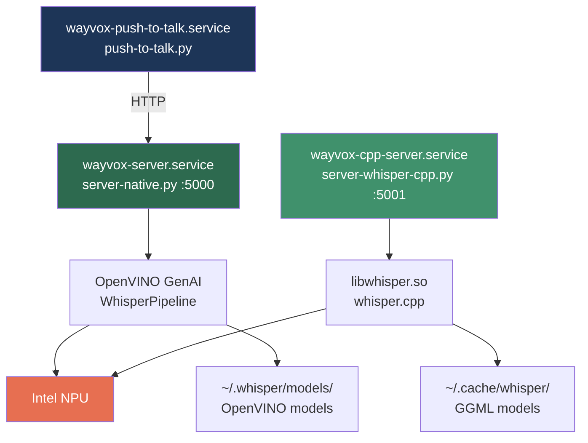

# Wayvox architecture

Wayvox is an on-device Linux dictation stack. Audio stays local while Whisper runs through OpenVINO, Intel NPU/GPU, CUDA, or CPU backends.

## System overview

## Runtime components

| Component | Role | Default port |
| --- | --- | --- |
| `server-native.py` | Full Whisper pipeline through OpenVINO | `5000` |
| `server-whisper-cpp.py` | Whisper.cpp with NPU encoder and CPU decoder | `5001` |
| `push-to-talk.py` | Keyboard, audio capture, transcription, and text injection | N/A |
| GNOME extension | Tray controls, settings, vocabulary, and About view | N/A |
| KDE plasmoid | Plasma controls and Language Buddy overlay | N/A |

The primary server is `wayvox-server.service`. Push-to-talk waits for its `/health` endpoint before listening for the configured key.

## Transcription flow

### Batch mode

1. Client posts WAV audio to `/transcribe`.
2. Server decodes audio to a 16 kHz float32 stream.
3. OpenVINO loads the selected Whisper model.
4. Whisper runs on the selected device.
5. Server returns `{"text": "..."}`.

### Streaming mode

1. Client posts audio to `/transcribe/stream`.
2. Server starts inference in a worker thread.
3. Token chunks are sent as Server-Sent Events.
4. The final event contains `done` and `full_text`.

### Push-to-talk mode

Hold the configured key to record and transcribe on release. A quick tap starts toggle mode, which sends audio every few seconds and types only changed text. Audio is captured through PipeWire. Text injection uses `ydotool`, `wtype`, clipboard paste, or `xdotool` depending on the session.

## Hardware

Primary hardware target is Intel Core Ultra with an Intel NPU at `/dev/accel/accel0`. CPU, Intel GPU, and CUDA paths are also supported when configured.

See [configuration.md](configuration.md) for device selection and model settings.
